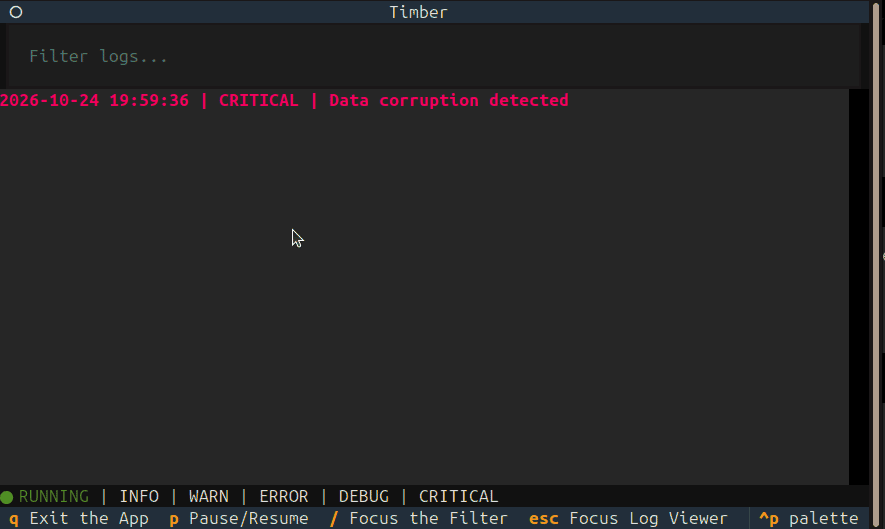

# 🌲 Timber



A terminal log viewer for terminal lovers.

For as long as I can remember, I've wanted to build a log viewer of my own. Not just any log viewer, but one built for terminal lovers and enthusiasts like myself.

I've always struggled with finding and opening log files just to read them. The mere thought of using `cat` or something similar to dig through logs made my stomach turn.

So I finally built Timber!

It's a little Python terminal app that lets you watch logs as they come in, see different log levels in colour, and filter through entries without leaving your keyboard.

It's not the best log viewer out there, but I'm really happy with it. I built it by hand as part of Hack Club Terra, mainly to learn how terminal user interfaces work. I'll probably keep working on it whenever I have the time.

Anyway, enough of that. Let's get into it.

## ✨ Features

- **Live log viewing** — watch new entries appear as they're written to a file.
- **Colour-coded log levels** — INFO, WARN, ERROR, DEBUG, and CRITICAL each have their own colour.
- **Text filtering** — search through logs by typing a word or phrase.
- **Level toggles** — show or hide individual log levels with a single key.
- **Pause and resume** — pause incoming updates and catch up when you're ready.
- **Smart scrolling** — Timber follows new entries when you're at the bottom, but won't pull you away when you're reading older logs.
- **Keyboard-driven interface** — filter, pause, and switch between log levels without reaching for your mouse.

## 🛠️ Installation

You'll need Python installed on your system.

### 1. Clone the repository

```bash
git clone https://github.com/NxtCreator/timber.git
cd timber
```

Replace the repository URL with your actual GitHub repository if the name or URL differs.

### 2. Create a virtual environment

**Linux / macOS**

```bash
python3 -m venv .venv
source .venv/bin/activate
```

**Windows (PowerShell)**

```powershell
py -m venv .venv
.venv\Scripts\Activate.ps1
```

If you're using Command Prompt instead of PowerShell, activate it with:

```bat
.venv\Scripts\activate.bat
```

### 3. Install the dependencies

With your virtual environment activated, run:

```bash
python -m pip install -r requirements.txt
```

That's it! You're ready to run Timber.

## 📦 Download

**Windows:** grab `timber.exe` and `sample.log` from the [latest release](https://github.com/NxtCreator/timber/releases/latest), put them in the same folder, and double-click `timber.exe`. Paste the path to `sample.log` when it asks. (Windows may warn about an unsigned app. That's expected.)

**macOS / Linux:** follow the installation steps below and run Timber from source.

**Just want to look around?** Run `python timber.py sample.log` to try Timber on the included sample log, with no generator needed.


## 🚀 Usage

Pass the path to a log file when starting Timber:

```bash
python timber.py path/to/file.log
```

For example:

```bash
python timber.py app.log
```

On Windows, you can use `py` instead of `python` if that's how Python is set up on your system.

Timber will open the file and start following new entries as they appear.

### Trying it out

Don't have a log file handy? No worries. I've included a little script that generates sample logs for testing.

**Start the generator first.** It creates `app.log`, and Timber exits if the file doesn't exist yet.

In one terminal, run:

```bash
python gen_logs.py
```

The script will ask how many logs you'd like to generate. Enter a positive number for a limited batch, or just press Enter to keep generating logs until you stop it (Ctrl+C).

Then, in a second terminal, run:

```bash
python timber.py app.log
```
Prefer something quicker? `sample.log` in this repo is a ready-made log file you can open right away.

Now you can watch the logs roll in and try out the filters yourself.

## ⌨️ Keyboard shortcuts

| Key | Action |
|---|---|
| `q` | Quit Timber |
| `p` | Pause / resume log updates |
| `/` | Focus the text filter |
| `Escape` | Return focus to the log viewer |
| `1` | Toggle INFO |
| `2` | Toggle WARN |
| `3` | Toggle ERROR |
| `4` | Toggle DEBUG |
| `5` | Toggle CRITICAL |

The level toggles let you hide the entries you don't want to see. Press the same key again to bring them back.

## 📄 Log format

Timber recognises log entries in this format:

```text
2026-10-24 14:32:07 | ERROR | Database connection failed
```

The format is:

```text
timestamp | LEVEL | message
```

Supported levels are `INFO`, `WARN`, `ERROR`, `DEBUG`, and `CRITICAL`.

Lines that don't match this format are still displayed, just without level-specific colouring. That means stack traces and other unrecognised lines won't disappear when you toggle log levels.

## 🧰 Built with

- [Python](https://www.python.org/)
- [Textual](https://textual.textualize.io/) — for the terminal user interface.
- [Rich](https://rich.readthedocs.io/) — for coloured output and text styling.


## 🗺️ Roadmap & known limitations

Timber is still a work in progress. Here's what it can't do yet.

**Known limitations**

- If the log file is truncated or rotated, Timber stops showing new lines (restart it to fix this).
- If the file is deleted while Timber is running, it crashes.
- Everything is kept in memory, so very large files aren't supported yet.
- The filter redraws the whole log on every keystroke, so it may feel slow on big files.
- A line that's still being written can briefly show up cut in half.

**Planned**

- Search: highlight matches and jump between them with `n` / `N`
- A help screen
- JSON-lines support
- Collapsing multi-line stack traces
- A timestamp range filter ("show the last 5 minutes")


## 🌱 A little note

Timber is a learning project, and there's still room to improve it. I built it because I wanted a tool like this for myself, and along the way, I got to learn a lot about building terminal user interfaces.

I know tools like `lnav` already exist. Timber isn't trying to replace them. This was my attempt at building something I've wanted for a long time and learning along the way.

If you've made it this far and decide to give Timber a try, I hope you enjoy it.

**For any geeks trying out my app, enjoy!** 🌲
